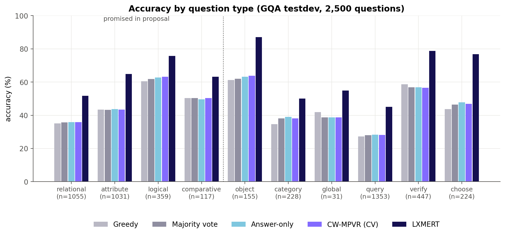
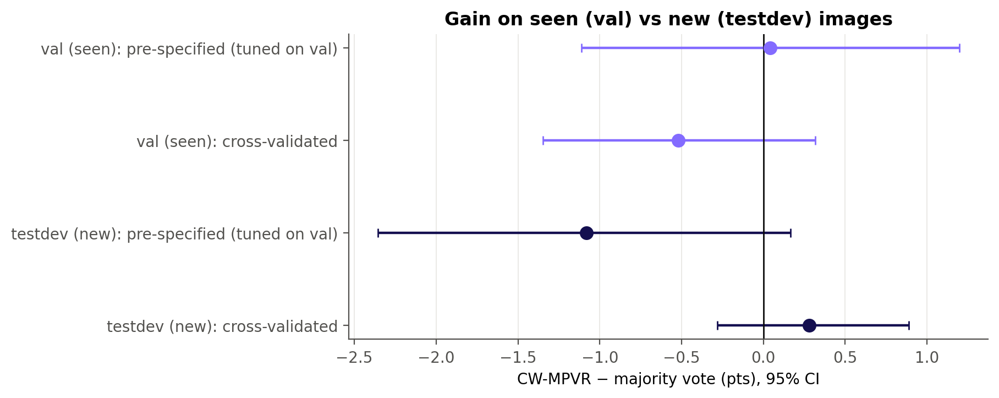

# CW-MPVR: Confidence-Weighted Multi-Path Visual Reasoning

Does a vision-language model answer multi-step visual questions better if it reasons several times and weights each attempt by **two separate confidence signals**: *is the evidence grounded in the image?* and *how sure is the model of the answer?*

Zero-shot **BLIP-2** on **GQA**, evaluated against greedy decoding, self-consistency, answer-confidence weighting and **LXMERT**, on two evaluation sets: the proposal's **val-balanced** subsample and a **testdev-balanced** subsample.

> COMP6001 Computer Vision and Multimodal Machine Learning · Final Project · Semester 2, 2026

---

## Key findings

**1. The two confidence signals do different jobs (a double dissociation), on both evaluation sets.**

| Job | Answer confidence | Grounding confidence |
|---|---|---|
| *Which path is right?* (within-question AUC; val / testdev) | 0.49 / 0.51: chance | **0.57 / 0.54**: useful |
| *Should the final answer be trusted?* (question-level AUROC, testdev) | **0.70**: useful | 0.48: chance |

**2. Decomposed confidence improves *knowing when to trust* an answer.** Combining path agreement with answer confidence raises AUROC from 0.681 to 0.727 (all signals vs agreement: +0.046, 95% CI 0.033–0.059, p < 0.001; grounding adds nothing on top). Answering only the most confident half gives 58.1% vs 54.2%.

**3. It does not significantly improve accuracy, on either evaluation set.**
- testdev: CW-MPVR 41.02% ± 0.29 (5 × 5-fold CV) vs 40.68% majority vote (+0.34 pts, n.s.).
- val (proposal protocol): CW-MPVR 42.68% (pre-specified) and 42.34% ± 0.17 (CV) vs 42.64% majority vote.
- No question type (relational, attribute, logical, comparative, ...) shows a significant gain after Holm correction.
- A correct answer exists in some path for 59.8% (testdev) and 63.3% (val) of questions: selecting the right path, not generating it, is the bottleneck.

**4. Grounding is more reliable on images seen in pretraining, and tuning-set gains do not transfer.**
- val images are Visual Genome (seen in BLIP-2 pretraining); testdev images are not. Grounding separates right from wrong paths better on seen images (AUC 0.569 vs 0.544).
- Weights tuned on the 500 calibration questions looked +3.2 pts better than majority vote there, but gave **+0.04 pts on fresh val questions** and **−1.08 pts on testdev**: the calibration gain was mostly selection optimism (best of 56 settings on the same data).
- Over-weighting grounding is harmless on seen images but harmful on new ones.

**5. ITM checks what is in the image, not whether an answer is correct.** Grounding scores rise when evidence names objects that exist in the scene graph (ρ = 0.22, p < 0.001), but scoring the question–answer pair directly gives no signal (AUC 0.50).

**6. Gains do not grow with reasoning depth** (−0.36 pts per extra step, p = 0.32, controlling for question type).

---

## Results


**testdev-balanced: 2,500 questions, 392 images** (95% CI: bootstrap resampling images)

| Method | Training on GQA | Accuracy (%) | 95% CI |
|---|---|---|---|
| Greedy (BLIP-2) | none | 40.20 | 38.16 – 42.23 |
| Majority vote (self-consistency) | none | 40.68 | 38.62 – 42.74 |
| Answer-only weighting | none | 41.12 | 39.01 – 43.22 |
| CW-MPVR, tuned on val (pre-specified) | none | 39.60 | 37.51 – 41.66 |
| Answer-only (CV, 5 × 5) | none | 40.98 ± 0.04 | – |
| Grounding-only (CV, 5 × 5) | none | 40.96 ± 0.18 | – |
| **CW-MPVR (CV, 5 × 5)** | none | **41.02 ± 0.29** | – |
| LXMERT | fine-tuned | 59.20 | 56.99 – 61.35 |
| *Oracle: a correct path exists* | – | *59.80* | – |

**val-balanced (proposal protocol): 2,500 questions, 2,087 images, no image shared with calibration**

| Method | Accuracy (%) | 95% CI |
|---|---|---|
| Greedy (BLIP-2) | 43.20 | 41.23 – 45.18 |
| Majority vote (self-consistency) | 42.64 | 40.69 – 44.60 |
| Answer-only weighting | 42.80 | 40.87 – 44.74 |
| CW-MPVR, tuned on calibration (pre-specified) | 42.68 | 40.71 – 44.57 |
| CW-MPVR (CV, 5 × 5) | 42.34 ± 0.17 | – |
| LXMERT (reported, testdev) | 60.0 | – |
| *Oracle: a correct path exists* | *63.32* | – |

*CV = image-grouped cross-validation repeated 5 times (mean ± SD); repeat 0 uses `data/cv_folds.csv`. LXMERT reproduces its published 60.0% on testdev using the authors' original features; on val it is quoted as reported, because its released model was trained on val.*

**Accuracy by question type (testdev; promised in the proposal)**

| Type | n | Greedy | Majority | CW-MPVR (CV) | LXMERT |
|---|---|---|---|---|---|
| Relational | 1,055 | 35.1 | 35.6 | 35.9 | 51.7 |
| Attribute | 1,031 | 43.5 | 43.3 | 43.4 | 64.9 |
| Logical | 359 | 60.5 | 61.8 | 63.2 | 75.8 |
| Comparative | 117 | 50.4 | 50.4 | 50.4 | 63.3 |



**When to trust an answer** (CW-MPVR answers on testdev, out-of-fold)

| Confidence signal | AUROC ↑ | AURC ↓ | Accuracy when answering 50% |
|---|---|---|---|
| Agreement between paths | 0.681 | 0.481 | 54.2 |
| Answer confidence | 0.704 | 0.433 | 55.4 |
| Grounding confidence | 0.479 | 0.625 | 39.4 |
| Agreement + answer | **0.727** | **0.422** | **58.2** |
| All three | 0.727 | 0.423 | 58.1 |


**Seen (val) vs new (testdev) images**



---

## Method

For each question, BLIP-2 FlanT5-XL samples **k = 10 paths**: an evidence sentence (two prompts × five samples, T = 1.0, top-p 0.95), then an answer decoded from that evidence. Each path *i* gets:

- **answer confidence** $a_i$: mean log-probability of the answer tokens
- **grounding confidence** $g_i$: log P(match) of the evidence from BLIP-2's image–text matching head

$$w_i = \text{softmax}_i(\beta a_i + \gamma g_i), \qquad \hat{y} = \arg\max_y \sum_{i:\, y_i = y} w_i$$

One rule covers every variant: β = γ = 0 is majority vote, γ = 0 is answer-only, β = 0 is grounding-only, β = γ is a single combined confidence. β and γ are chosen by grid search on held-out data only. Aggregation is implemented from scratch (`src/aggregate.py`, `src/cwmpvr.py`, `src/protocol.py`).

```
GQA question + image
      │
      ├── BLIP-2 greedy ────────────────────────────► Greedy baseline
      │
      └── BLIP-2 × 10 paths: evidence → answer
               │            │
         answer conf.   ITM grounding
               └──── weighted vote ────────────────► CW-MPVR
                     (generated once, cached; every method reads the same cache)
```

## Dataset

**GQA** (Hudson & Manning, 2019) is multimodal: every sample pairs a real photograph with a natural-language question, a short answer, type labels and a functional program; val images also come with scene graphs.

| Split | Use | Questions | Images |
|---|---|---|---|
| val-balanced | **evaluation, proposal protocol** (stratified by structural × semantic type) | 2,500 of 132,062 | 2,087 |
| val-balanced | calibration (tuning β, γ), scene-graph analysis | 500 | 478 |
| testdev-balanced | evaluation on images unseen in pretraining (stratified) | 2,500 of 12,578 | 392 |

The val evaluation and calibration sets share no images. Samples are proportional stratified draws (fixed seed), checked for representativeness (χ² p = 0.94 and 0.92). Questions can share images, so all confidence intervals resample **images**.

## Benchmarks

| Method | Why |
|---|---|
| Greedy | Standard single-answer BLIP-2 inference: the floor |
| Majority vote (Wang et al., 2023) | Same paths, unweighted: isolates the value of weighting |
| Answer-only weighting (Wang et al., 2023) | Same paths, answer confidence only: isolates the value of grounding |
| LXMERT (Tan & Bansal, 2019) | Established GQA model, fine-tuned on GQA: supervised reference point |

All BLIP-2 methods read the same cached paths and are scored with the same metrics, intervals and tests.

## Repository structure

```
cw-mpvr/
├── notebooks/
│   ├── 00_setup.ipynb                     Colab + Drive + GitHub setup
│   ├── 01_data_eda.ipynb                  GQA loading, EDA, stratified samples, images
│   ├── 02_generate_paths.ipynb            BLIP-2 paths + both confidence signals (GPU)
│   ├── 03_baselines.ipynb                 Greedy, majority vote, answer-only, LXMERT
│   ├── 04_cwmpvr.ipynb                    CW-MPVR, tuning, ablations, k-sweep, complexity, diagnosis
│   ├── 04b_answer_grounding.ipynb         Pre-declared follow-up: question–answer grounding
│   ├── 05_analysis.ipynb                  Significance, depth, scene graphs, calibration, failures
│   ├── 06_types_repeated_cv_testdev.ipynb Proposal question types + repeated 5 × 5 CV (testdev)
│   └── 07_val_protocol.ipynb              Proposal protocol on val-balanced; seen vs new images (GPU)
├── src/
│   ├── gqa.py         loading, stratified sampling, scene-graph statistics
│   ├── paths.py       BLIP-2 generation, log-probabilities, ITM/ITC scoring, cache
│   ├── aggregate.py   weighted voting (from scratch)
│   ├── cwmpvr.py      CW-MPVR scoring, grid search, confidence features
│   ├── protocol.py    repeated image-grouped CV, paired comparisons, per-type tables
│   ├── evaluate.py    accuracy, image-clustered bootstrap, McNemar
│   ├── errorlog.py    log_error() → ERROR_LOG.md
│   ├── gitsync.py     commit/push from Colab
│   └── utils.py       config, seeding
├── configs/default.yaml   all settings (sample sizes, k, temperature, models, seed)
├── data/                  sample ID lists (testdev, val-eval, calibration) and CV folds
├── results/               cached paths (.jsonl.gz), tables (.csv), tuned weights
├── figures/               all report figures
└── ERROR_LOG.md           every development error, its cause and its fix
```

## How to reproduce

Run in Google Colab, in order. Every notebook starts with the same setup cell and ends by pushing to GitHub.

| Notebook | Runtime | Time |
|---|---|---|
| 00, 01 | CPU | ~10 min (image download) |
| 02 | **L4 GPU** | ~80 min for 3,000 questions |
| 03, 04b | T4 GPU | ~5–10 min each |
| 04, 05, 06 | CPU | ~1–3 min each |
| 07 | **L4 GPU** | ~75 min for 2,500 questions |

**Without a GPU**: notebooks 03 (except LXMERT), 04, 05, 06 and the analysis part of 07 run from the cached paths in `results/paths_*.jsonl.gz`.

**Setup**: add a GitHub token with *Contents: read and write* as a Colab secret named `GITHUB_TOKEN`, open `notebooks/00_setup.ipynb`, set `GITHUB_USER`, run all. Raw GQA files and images go to `MyDrive/cw-mpvr-data/` (not in git).

## Complexity

- **Generation**: O(N · k · (L_e + L_a)) decoder steps plus O(N · k) ITM passes; ≈1.5–1.6 s per question on an L4; ≈11 GB GPU memory, constant in N. Cost is linear in k.
- **Aggregation**: O(N · k) time and memory; 28 µs per question, 4 MB for 25,000 paths, no GPU. Repeated CV multiplies this by repeats × folds × grid size.

## Limitations

- Evidence sentences are short (~3 words), so grounding mostly checks object presence, not relations.
- Tuning-set gains are optimistic: the best of 56 weight settings on 500 calibration questions did not replicate on fresh questions; only held-out or cross-validated results are reported as evidence.
- val images were seen in BLIP-2 pretraining; testdev images were not. Both are reported; the scene-graph check (H4) is only possible on val.
- One backbone (BLIP-2 FlanT5-XL), one dataset and 2,500-question samples; gains below ~1 point cannot be resolved.
- Exact-match accuracy after light normalisation; synonyms count as wrong.

## Error log

Full details in [`ERROR_LOG.md`](ERROR_LOG.md).

| # | Problem | Fix |
|---|---|---|
| E01 | `autoreload` fails on Colab's Python 3.13 (`imp` removed) | Removed; restart after editing `src/` |
| E02 | Paths nearly identical (mode collapse) | Sampling T 0.7 → 1.0, top-p 0.9 → 0.95 (tuned on val) |
| E03 | LXMERT demo detector deleted from Hugging Face | Authors' original GQA testdev features |
| E04 | Val-tuned weights hurt testdev accuracy | Diagnosed; added image-grouped CV and the val-eval comparison |
| E05 | Same CV gave slightly different results across notebooks | Fixed folds saved to `data/cv_folds.csv` |

## Relation to the proposal

**Delivered as proposed**
- Dataset: GQA, stratified subsample of the balanced **validation** split (2,500 questions).
- Method: CW-MPVR on BLIP-2, k paths, visual-grounding and answer confidence, confidence-weighted aggregation.
- Benchmarks: greedy decoding, self-consistency majority voting, LXMERT (reported accuracy).
- Evaluation: accuracy overall and for relational, logical, attribute and comparative questions; multiple samplings (repeated 5 × 5-fold CV and image-level bootstrap).

**Added beyond the proposal**
- A second evaluation set, **testdev-balanced**, whose images BLIP-2 never saw and on which LXMERT was never trained.
- LXMERT **run** on the testdev questions (59.2%, published 60.0%), in addition to its reported accuracy.
- A fourth benchmark, **answer-only weighting**, to isolate the grounding signal.
- Holm-corrected paired tests, depth and scene-graph analyses, calibration and abstention, and a pre-declared answer-grounding follow-up.

## References

- Hudson, D. A., & Manning, C. D. (2019). GQA: A new dataset for real-world visual reasoning and compositional question answering. *CVPR*.
- Li, J., Li, D., Savarese, S., & Hoi, S. (2023). BLIP-2: Bootstrapping language-image pre-training with frozen image encoders and large language models. *ICML*.
- Wang, X., Wei, J., Schuurmans, D., Le, Q., Chi, E., Narang, S., Chowdhery, A., & Zhou, D. (2023). Self-consistency improves chain of thought reasoning in language models. *ICLR*.
- Tan, H., & Bansal, M. (2019). LXMERT: Learning cross-modality encoder representations from transformers. *EMNLP*.
- Anderson, P., et al. (2018). Bottom-up and top-down attention for image captioning and visual question answering. *CVPR*.
- Khan, Z., & Fu, Y. (2024). Consistency and uncertainty: Identifying unreliable responses from black-box vision-language models for selective visual question answering. *CVPR*.
- Guo, C., Pleiss, G., Sun, Y., & Weinberger, K. Q. (2017). On calibration of modern neural networks. *ICML*.
- Geifman, Y., & El-Yaniv, R. (2017). Selective classification for deep neural networks. *NeurIPS*.
- McNemar, Q. (1947). Note on the sampling error of the difference between correlated proportions or percentages. *Psychometrika*.
- Holm, S. (1979). A simple sequentially rejective multiple test procedure. *Scandinavian Journal of Statistics*.
